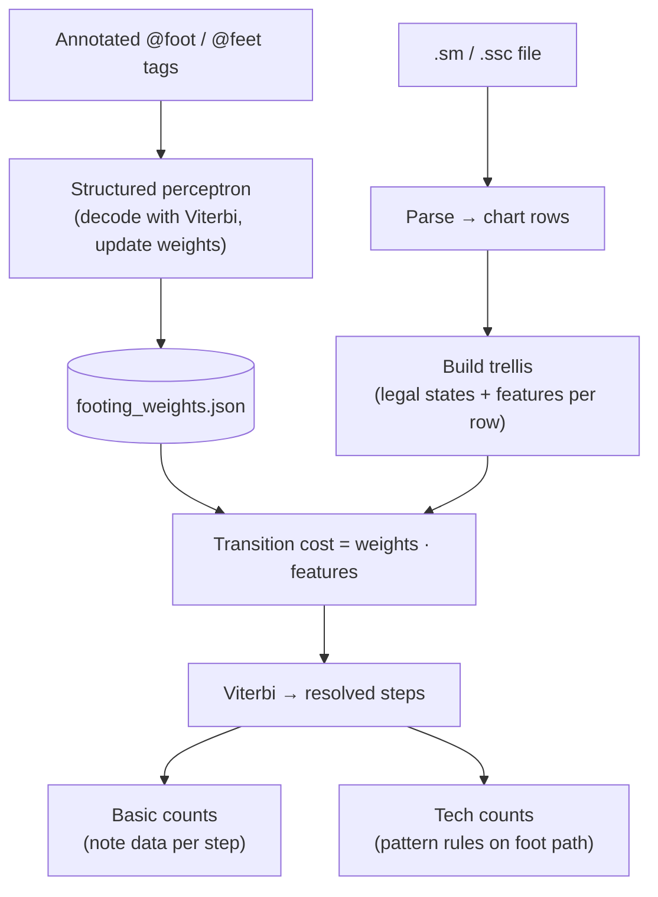

# Patternity

`patternity` is a Python library for parsing and analyzing StepMania `.sm` and `.ssc` 4-panel charts.

```bash
uv sync
uv run patternity -f path/to/chart.ssc -a
```

See [`docs/`](docs/README.md) for usage, architecture, the footing model, training, and debugging.

## Identifying Patterns

`patternity` takes inspiration from automatic piano fingering research to infer which foot hits each arrow using the Viterbi algorithm. For each chart row it builds a trellis of legal foot states, scores transitions with a linear feature model, determines the cheapest path with Viterbi, and learns those weights with a structured perceptron on hand-annotated charts. Tech pattern counts (jacks, footswitches, brackets, etc.) are subsequently derived from the inferred footing using community rules.



Full pipeline (basic metrics, movement cost, modules): [`docs/architecture.md`](docs/architecture.md).
