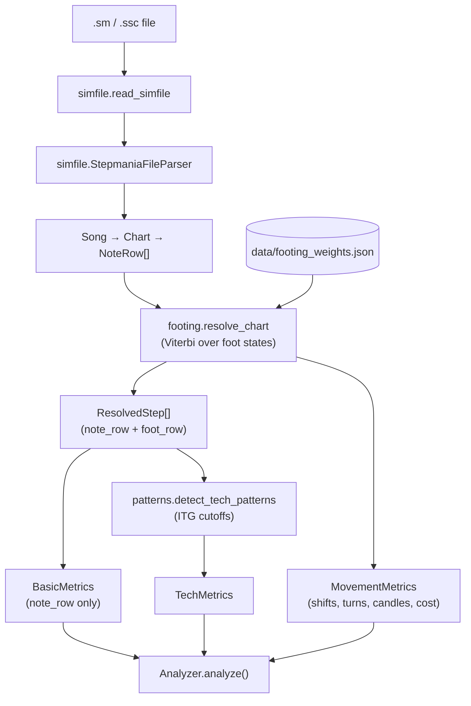

# Architecture

## Pipeline



1. **Read and parse.** `read_simfile` loads the text; `StepmaniaFileParser.parse` turns it into a `Song` with a `Header` and one `Chart` per difficulty. Each chart's `notes` is a list of `NoteRow`s (empty `0000` rows are dropped) carrying measure, beat, quantization, timestamp (from `#BPMS` / `#STOPS` / `#OFFSET`), and which holds/rolls are active. See [File format](format.md).
2. **Footing.** `footing.resolve_chart` finds the cheapest physically legal sequence of foot positions for the whole chart and returns one **`ResolvedStep`** per row (`note_row` plus decoded `foot_row`). The cost of each move is a learned linear function of a few generic features. The same decode supplies **`MovementMetrics`**: total path cost and whether any row needed a relaxed (penalized) fallback. See [Footing model](footing-model.md).
3. **Basic metrics.** `Analyzer` walks `resolved.steps` and feeds each `note_row` into `BasicMetrics`. Counts are chart notation only (taps, jumps, holds, …); they do **not** use `foot_row` and do not change when footing weights change.
4. **Tech labels.** `patterns.detector.detect_tech_patterns` walks the same steps and labels jacks, switches, doublesteps, brackets, and crossovers using community / ITGmania timing cutoffs into **`TechMetrics`**.
5. **Movement metrics.** `MovementMetrics.from_decode` sets `direction_shifts` and `candles` from `movement/detector.py`, `turns` from `tech.crossovers`, plus path cost and feasibility.
6. **Report.** `Analyzer.analyze()` returns the `basic`, `tech`, and `movement` dictionaries (see [Usage → Output](usage.md#output)).

## Modules

The package is split by pipeline stage. Each subpackage's `__init__` re-exports its main entry points; the top-level `patternity` package exports `read_simfile`, `StepmaniaFileParser`, `Analyzer`, `resolve_chart`, `FootingModel`, and `detect_tech_patterns`.

```text
src/patternity/
  __init__.py  analyzer.py  cli.py  metrics.py
  simfile/     reader, parser, song, notes, timing, serializer
  footing/     stance, transitions, features, search, model, resolve
  patterns/    spans, detector
  training/    __main__, annotations, trainer, corpus, evaluation
  data/        footing_weights.json
```

### Runtime (shipped in the package)

| Module | Responsibility |
|--------|----------------|
| `simfile/reader.py` | Read a simfile from disk (checks the extension). |
| `simfile/parser.py` | Split sections, parse header tags, charts, measures, and timing. |
| `simfile/song.py` | `Song`, `Header`, `Chart`, `ChartMetadata`, `GrooveRadar`, `Difficulty`. |
| `simfile/notes.py` | `NoteRow` (one row of four columns plus derived timing), `NoteType`, and `AnchorTracker` (hold/roll state while parsing). |
| `simfile/timing.py` | `TimingEngine`: beat → seconds across `#BPMS` and `#STOPS`. |
| `simfile/serializer.py` | Song ⇄ JSON. |
| `footing/stance.py` | Foot geometry: `FootPlacement` (a panel or a two-panel bracket), `Stance` (both feet plus orientation), `FootMove`, and `FootRow` (the search state). |
| `footing/transitions.py` | Hard physical rules: every legal next `FootRow` from a given one on a given row. |
| `footing/features.py` | `FEATURE_NAMES` and `featurize`: what the feet do on each transition. |
| `footing/search.py` | Trellis construction, Viterbi, per-row confidence. |
| `footing/model.py` | `FootingModel` (weights) and the packaged-weights path. |
| `footing/resolve.py` | `resolve_chart`, `ResolvedStep`, `FootingResult`. |
| `patterns/spans.py` | `PatternKind` and `PatternSpan` (one detection with its steps). |
| `patterns/detector.py` | Tech-pattern labeling on a decoded path. The only place ITG timing cutoffs appear. |
| `metrics.py` | `BasicMetrics`, `TechMetrics` (spans plus counts), `MovementMetrics`. |
| `movement/detector.py` | `direction_shifts` and `candles` on a resolved path. |
| `analyzer.py` | Ties the steps above together for one chart. |
| `cli.py` | The `patternity` command. |
| `data/footing_weights.json` | The trained weights loaded by default. |

`patterns/__init__` re-exports only the span types. `metrics.py` depends on them and `patterns/detector.py` depends on `metrics.py`, so import the detector from `patternity.patterns.detector` (or `patternity`).

### Training and evaluation (developer tooling)

| Module / script | Responsibility |
|-----------------|----------------|
| `training/annotations.py` | Parse `@foot` / `@feet` / `@pattern` comments in fixture charts and align them to parsed rows. |
| `training/trainer.py` | Structured perceptron trainer, leave-one-chart-out, `row_errors`. |
| `training/corpus.py` | Reads `tests/fixtures/training_corpus.txt` and finds the fixtures root. |
| `training/evaluation.py` | Per-row footing accuracy, per-pattern precision/recall, and disagreement reports against annotations. |
| `training/__main__.py` | `python -m patternity.training`: retrains and writes the packaged weights. |
| `scripts/evaluate.py` | Prints evaluation reports for the training corpus (optionally leave-one-chart-out). |
| `scripts/suggest_annotations.py` | Writes model suggestions into a chart as `@suggest=` tags for human review. |

### Tests

| Path | What it covers |
|------|----------------|
| `tests/unit/` | Parser, reader, CLI, stance geometry (`test_footing_stance.py`), footing (Viterbi vs brute force, confidence, training smoke test), labeler rules. |
| `tests/integration/test_foot_path.py` | Per-row footing accuracy thresholds and pattern-tag F1 on annotated fixtures. |
| `tests/integration/test_canonical.py` | End-to-end counts against hand-counted `tests/fixtures/canonical/*.json`. |
| `tests/integration/test_chart_basic_metrics.py` | Basic metrics on real charts. |

## Tech labels

All cutoffs live in `patterns/detector.py`. Labels are computed on the decoded foot path, so they are only as good as the footing.

Jacks and switches only pair a panel with the **very next press row**, as in ITGmania. Returning to a panel after other steps (for example Down, Up, Down in a stream) is neither.

| Label | Rule |
|-------|------|
| Jack | The same foot presses the same panel twice in a row, less than 0.176 s apart. Hold tails don't count as presses. |
| Footswitch | The other foot takes over an Up or Down panel within 1/3 s (90 BPM 8ths count). After a hold release (a holdswitch) a mine cue is required. |
| Sideswitch | Same as a footswitch, on the Left or Right panel. |
| Doublestep | Two consecutive single-panel presses by the same foot on different panels, unless the other foot released a hold in between. |
| Bracket | One foot presses two panels on the same row. |
| Crossover | A run of crossed-orientation steps (one foot past the other), including the step before and after. Inverted (fully backwards) runs are counted too. |

## Movement metrics

Computed from the same decoded foot path as tech labels (`movement/detector.py` + `MovementMetrics.from_decode`). Like tech, these counts can change if footing weights change; they do not use ITG jack/footswitch timing cutoffs.

| Metric | Rule |
|--------|------|
| `direction_shifts` | On each press row, +1 when orientation changes between `FACING_LEFT` and `FACING_RIGHT` (same condition as the `facing_flip` training feature; neutral and inverted transitions are ignored). |
| `turns` | Equals `tech.crossovers` for that analyze call (crossover + inverted crossover spans from `patterns/detector.py`). |
| `candles` | Per foot, one count per **maneuver run** (maximal consecutive press rows where that foot moved): either L-side and R-side placements both appear with a U/D touch in the run, or both U and D are touched in the run (e.g. L→D→R, or R-foot U then D while the other foot stays put). |
| `total_cost` | Sum of weighted transition costs on the chosen path. |
| `foot_path_feasible` | `False` if any row used a relaxed (penalized) fallback. |

## Where to change what

| You want to… | Change |
|--------------|--------|
| Fix how a pattern is *counted* (cutoffs, pairing rules) | `patterns/detector.py` |
| Fix how a passage is *footed* | Annotate it and retrain ([Training workflow](training.md)). Only add or change a feature in `footing/features.py` (`featurize`) when the existing features cannot express the distinction ([Footing model](footing-model.md#adding-a-feature)). |
| Allow or forbid a physical move outright | `footing/transitions.py` (hard rules) |
| Change what basic metrics count | `metrics.py` (`BasicMetrics.add_note`) |
| Change movement counts (shifts, candles) | `movement/detector.py` |
| Support a new simfile tag | `simfile/parser.py`, `simfile/song.py` |
