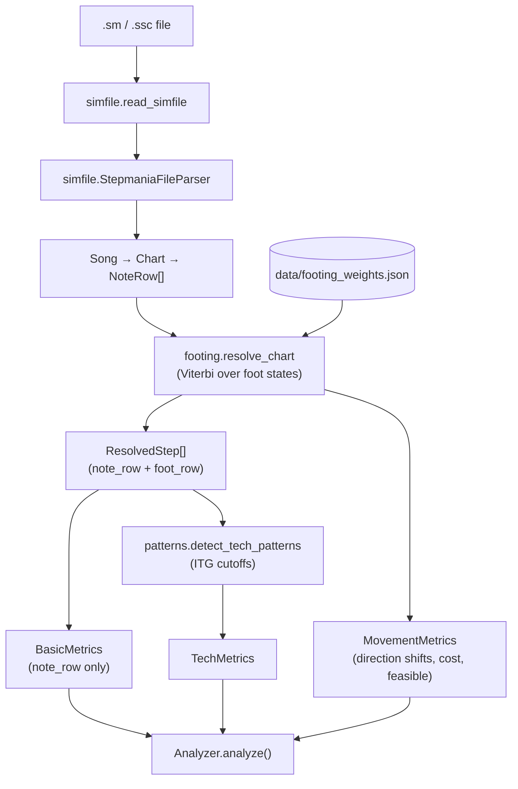

# Architecture

## Pipeline



1. **Read and parse.** `read_simfile` loads the text; `StepmaniaFileParser.parse` turns it into a `Song` with a `Header` and one `Chart` per difficulty. Each chart's `notes` is a list of `NoteRow`s (empty `0000` rows are dropped) carrying measure, beat, quantization, timestamp (seconds from beat 0, from `#BPMS` / `#STOPS`; `#OFFSET` is not applied since only time differences matter), and which holds/rolls are active. See [File format](format.md).
2. **Footing.** `footing.resolve_chart` finds the cheapest physically legal sequence of foot positions for the whole chart and returns one **`ResolvedStep`** per row (`note_row` plus decoded `foot_row`). The cost of each move is a learned linear function of a few generic features. The same decode supplies **`MovementMetrics`**: total path cost and whether any row needed a relaxed (penalized) fallback. See [Footing model](footing-model.md).
3. **Basic metrics.** `Analyzer` walks `resolved.steps` and feeds each `note_row` into `BasicMetrics`. Counts are chart notation only (taps, jumps, holds, …); they do **not** use `foot_row` and do not change when footing weights change.
4. **Tech labels.** `patterns.detector.detect_tech_patterns` walks the same steps and labels jacks, switches, doublesteps, brackets, crossovers, and candles using community / ITGmania timing cutoffs into **`TechMetrics`**.
5. **Movement metrics.** `movement.detect_movement` counts `direction_shifts` on the same steps and copies path cost and feasibility from the decode.
6. **Report.** `Analyzer.analyze()` returns the `basic`, `tech`, and `movement` dictionaries (see [Usage → Output](usage.md#output)).

## Modules

The package is split by pipeline stage. Each subpackage's `__init__` re-exports its main entry points; the top-level `patternity` package exports `read_simfile`, `StepmaniaFileParser`, `Panel`, `Analyzer`, `resolve_chart`, `FootingModel`, and `detect_tech_patterns`.

```text
src/patternity/
  __init__.py  cli.py
  analysis/    analyzer, metrics
  simfile/     reader, parser, song, notes, timing, serializer
  footing/     stance, rules, transitions, grace, features, search, model, resolve
  patterns/    spans, detector
  movement/    detector
  training/    __main__, annotations, trainer, corpus, evaluation
  data/        footing_weights.json
```

### Runtime (shipped in the package)

| Module | Responsibility |
|--------|----------------|
| `simfile/reader.py` | Read a simfile from disk (checks the extension). |
| `simfile/parser.py` | Split sections, parse header tags, charts, measures, and timing. |
| `simfile/song.py` | `Song`, `Header`, `Chart`, `ChartMetadata`, `GrooveRadar`, `Difficulty`. |
| `simfile/notes.py` | `NoteRow` (one row of four columns plus derived timing), `NoteType`, `Panel` (the set-of-panels flag, e.g. `Panel.U in row.pressed`, and the only place the bit layout lives), and `AnchorTracker` (hold/roll state while parsing). |
| `simfile/timing.py` | `TimingEngine`: beat → seconds across `#BPMS` and `#STOPS`. |
| `simfile/serializer.py` | Song ⇄ JSON. |
| `footing/stance.py` | Foot geometry: `FootPlacement` (a panel or a two-panel bracket), `Stance` (both feet plus orientation), `FootMove`, and `FootRow` (the search state). |
| `footing/rules.py` | Hard physical rules: `RowContext`, `Candidate`, and the named rules in `RULES` that decide whether a proposed foot placement is legal. |
| `footing/transitions.py` | Proposes candidate foot moves, filters them through `rules.RULES`, and builds every legal next `FootRow` (hold owners, jack/switch tracking). |
| `footing/grace.py` | Grace windows before hold/roll tails, during which the owning foot may leave early. |
| `footing/features.py` | `FEATURE_NAMES` and `featurize`: what the feet do on each transition. |
| `footing/search.py` | Trellis construction, Viterbi, per-row confidence. |
| `footing/model.py` | `FootingModel` (weights) and the packaged-weights path. |
| `footing/resolve.py` | `resolve_chart`, `ResolvedStep`, `FootingResult`. |
| `patterns/spans.py` | `PatternKind` and `PatternSpan` (one detection with its steps). |
| `patterns/detector.py` | Tech-pattern labeling on a decoded path. The only place ITG timing cutoffs appear. |
| `analysis/metrics.py` | `BasicMetrics`, `TechMetrics` (spans plus counts), `MovementMetrics`. |
| `movement/detector.py` | `detect_movement`: direction shifts, path cost, and feasibility on a resolved path. |
| `analysis/analyzer.py` | Ties the steps above together for one chart. |
| `cli.py` | The `patternity` command. |
| `data/footing_weights.json` | The trained weights loaded by default. |

`patterns/__init__` re-exports only the span types. `analysis/metrics.py` depends on them and `patterns/detector.py` depends on `analysis/metrics.py`, so import the detector from `patternity.patterns.detector` (or `patternity`).

### Training and evaluation (developer tooling)

| Module / script | Responsibility |
|-----------------|----------------|
| `training/annotations.py` | Parse `@foot` / `@feet` / `@pattern` comments in fixture charts and align them to parsed rows. |
| `training/trainer.py` | Structured perceptron trainer, leave-one-chart-out, `row_errors`. |
| `training/corpus.py` | Reads `tests/fixtures/training_corpus.txt` and finds the fixtures root. |
| `training/evaluation.py` | Per-row footing accuracy, per-pattern precision/recall, and disagreement reports against annotations. |
| `training/__main__.py` | `python -m patternity.training`: retrains and writes the packaged weights. |
| `scripts/evaluate.py` | Prints evaluation reports for the training corpus (optionally leave-one-chart-out). |
| `scripts/suggest_annotations.py` | Writes model foot and pattern suggestions into a chart as `@suggest_foot=` / `@suggest_feet=` / `@suggest_pattern=` tags for human review. |

### Tests

| Path | What it covers |
|------|----------------|
| `tests/unit/` | Parser, reader, CLI, stance geometry (`test_footing_stance.py`), footing (Viterbi vs brute force, confidence, training smoke test), labeler rules. |
| `tests/integration/test_foot_path.py` | Per-row footing accuracy thresholds and pattern-tag F1 on annotated fixtures. |
| `tests/integration/test_canonical.py` | End-to-end counts against hand-counted `tests/fixtures/canonical/*.json`. |
| `tests/integration/test_chart_basic_metrics.py` | Basic metrics on real charts. |

## Tech labels

All cutoffs live in `patterns/detector.py`. Labels are computed on the decoded foot path, so they are only as good as the footing.

Jacks and switches only pair a panel with the **very next press row**, as in ITGmania. Returning to a panel after other steps (for example Down, Up, Down in a stream) is neither.

| Label | Rule |
|-------|------|
| Jack | The same foot presses the same panel twice in a row, less than 0.176 s apart. Hold tails don't count as presses. |
| Footswitch | The other foot takes over an Up or Down panel within 1/3 s (90 BPM 8ths count). After a hold release (a holdswitch) a mine cue is required. |
| Sideswitch | Same as a footswitch, on the Left or Right panel. |
| Doublestep | Two consecutive single-panel presses by the same foot on different panels, unless the other foot released a hold in between. |
| Bracket | One foot presses two panels on the same row. |
| Crossover | Each time the legs become crossed (left foot strictly right of the right foot), or turn to a different orientation while staying crossed, anchored on that first crossed step. Stepping to an uncrossed stance ends it even if the player stays turned (Up, Left then Up, Down then Right, Down is two crossovers). Inverted (fully backwards) crossovers are counted too. |
| Candle | A foot's press lands on the panel opposite its own previous press (Up↔Down or Left↔Right), whatever the other foot did in between. A bracket that keeps one of its panels (for example LU to LD) is not a candle. Examples: Up, Right, Down in a stream (the left foot goes Up to Down); the crossover Left, Down, Right; the left foot anchored on Left while the right foot hits Up then Down. |

## Movement metrics

Computed by `movement/detector.py` from the same decoded foot path as tech labels, so `direction_shifts` can change if footing weights change.

| Metric | Rule |
|--------|------|
| `direction_shifts` | On each press row with a facing orientation, +1 when it differs from the last facing orientation (`FACING_LEFT` ↔ `FACING_RIGHT`). Neutral and inverted rows are transition phases that keep the last facing direction, so left → neutral → right counts 1 and a crossover that returns to its starting side counts 0. This differs from the `facing_flip` training feature, which only fires on direct consecutive flips. |
| `total_cost` | Sum of weighted transition costs on the chosen path. |
| `foot_path_feasible` | `False` if any row used a relaxed (penalized) fallback. |

For where to make common changes, see the [Development guide](development.md#where-to-change-what).
