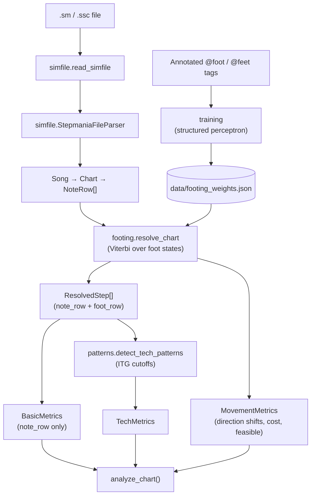

# Architecture

## Scope

- Parse `.sm` and `.ssc` files, including song header data, chart metadata, and groove radar values.
- Analyze 4-panel singles charts. Doubles are out of scope.
- Lifts and fakes are parsed and counted in the basic metrics, but footing never steps on them. ITG charts don't use lifts.

## Pipeline



- **Parsing** drops empty `0000` rows. Timestamps are seconds from beat 0 using `#BPMS` and `#STOPS`; `#OFFSET` is not applied, since only time differences matter. See [File format](format.md).
- **Footing** finds the cheapest legal sequence of foot positions for the whole chart. See [Footing model](footing-model.md).
- **Basic metrics** read chart notation only, so they don't change when the weights do. Tech and movement metrics read the decoded foot path, so they can.
- **Training** fits the weights offline with the same Viterbi decoder. See [Training workflow](training.md).
- **Tech patterns** are defined in [Patterns](patterns.md); the output fields are described in [the README](../README.md#output).

## Modules

One package per pipeline stage. Imports run one way: `simfile ← footing ← patterns, movement ← analysis`. Each package's `__init__` re-exports its entry points.

```text
src/patternity/
  simfile/     read and parse a file into Song → Chart → NoteRow
  footing/     legal foot states, transition features, Viterbi, weights
  patterns/    tech-pattern spans and counts on a decoded foot path
  movement/    direction shifts, path cost, feasibility
  analysis/    basic metrics; analyze_chart composes the stages
  training/    annotations, perceptron trainer, evaluation
  data/        footing_weights.json, the packaged weights
  cli.py       the patternity command
scripts/
  evaluate.py              accuracy and pattern scores against annotations
  suggest_annotations.py   write the model's footing into a chart for review
  pattern_diagrams.py      regenerate the SVGs in docs/images
```

For where to make a given change, see the [Development guide](development.md#where-to-change-what).

## Design principles

### Footing

- **Weights are learned, never hand-tuned.** A transition's cost is the weighted sum of its features, and the weights come from training on annotated charts.
- **Features are pattern-agnostic.** They describe what the feet do (same foot again, travel, crossing, speed, mine cues), never named patterns or ITG timing cutoffs.
- **Hard rules only forbid the impossible.** `footing/rules.py` decides what is legal, such as leaving a hold too early or ignoring a pressed panel. Anything merely undesirable is a cost: leaving a hold inside its grace window is legal and priced by `hold_release` and `early_release`.
- **The search is exact.** The trellis is never pruned, so Viterbi sees every legal state and returns the cheapest path, not a local minimum.

### Patterns

- **ITG and community cutoffs live only in `patterns/detector.py`.** The detector reads the decoded foot path, so pattern counts are only as good as the footing.

### Annotations

- **Annotations never come from model output.** `scripts/suggest_annotations.py` only writes `@suggest_…` tags; a person accepts each one by dropping the prefix.
- **Partial annotation is allowed.** Untagged rows are left to the model, and ambiguous passages should stay untagged.
- **Canonical counts are hand-counted.** `tests/fixtures/canonical/*.json` must not be filled from analyzer output.

## Tests

Unit tests in `tests/unit/` cover each stage on small inputs. The integration tests check four different things:

| Test | Compared against | Catches |
|------|------------------|---------|
| `test_foot_path.py` | `@foot` / `@feet` / `@pattern` tags in fixture charts | Footing accuracy below a per-chart floor, impossible tags, any change in per-pattern true / false positive counts |
| `test_canonical.py` | Hand-counted `tests/fixtures/canonical/*.json` | Wrong end-to-end basic and tech counts |
| `test_snapshots.py` | `tests/fixtures/snapshots/` | Any unintended change in output. Not ground truth; `--update-snapshots` rewrites it. |
| `test_chart_basic_metrics.py` | Known counts for real charts | Wrong basic metrics |
