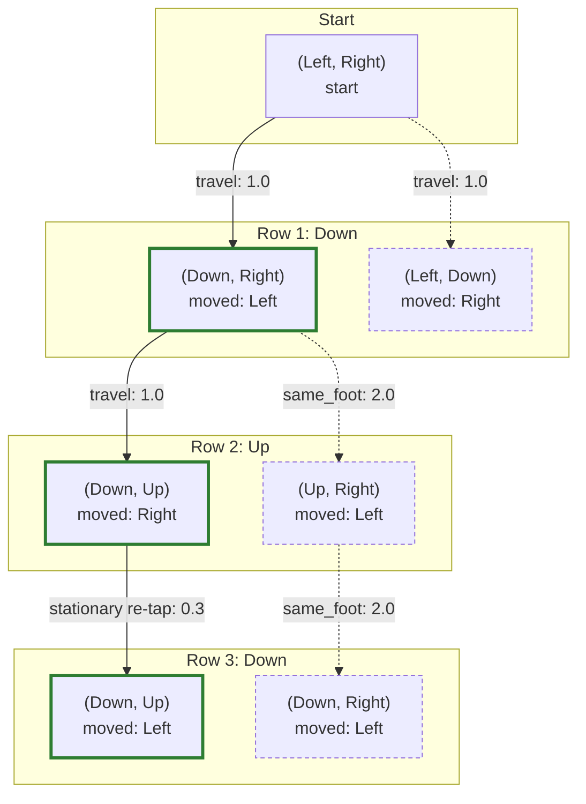

# Footing Model

The fundamental building block for identifying patterns is player footing. To replicate player foot selection, we model the state at each row (player stance, active holds, etc.) and possible legal transitions between them as a graph and use Viterbi to solve for the lowest cost path. This inferred footing becomes the basis for deriving various tech patterns like footswitches or brackets.

## Viterbi Search

### Hidden State

Each row of the chart has a set of possible player states. A `FootRow` (`footing/stance.py`) captures information about player position, footing used to obtain that position, intermediate mines, same-panel repetition, etc.

Every field takes part in equality and hashing. Two paths only merge in the search when everything that affects future costs is identical, so the search is **exact**; no pruning or beam search is performed.

### Transition Rules

Between each pair of states are a set of possible transitions (`footing/transitions.py`). We iterate over physically possible next states with several requirements:

- Every pressed panel is covered by a moving foot
- No foot moves to an unpressed panel (unless it is already held)
- Active holds and rolls stay covered by the "owning" foot at that point in time
- Individual placements can only be single panel or legal two-panel presses (i.e. brackets)

> [!NOTE] 
> We account for the hold/roll grace windows (`footing/grace.py`) since StepMania doesn't instantly penalize a lifted foot as long as the panel is re-pressed within said window.

> [!WARNING] 
> A row without a legal state (possibly from a malformed chart or incorrect annotation) defaults to a large penalty `RELAXED_PENALTY`.

### Cost Features

Each transition is stored in a feature vector `FEATURE_NAMES` (see `footing/features.py`). These are physical player stance, movement, or state descriptions, not pattern names.

> [!IMPORTANT]
> The cost of a transition is the dot product of its `weights` and `features`. The cost of a path is simply the sum over its moves!

### Footing Decoding

`build_trellis` (`footing/search.py`) enumerates all states for every row once (it doesn't depend on the weights) and stores each edge's feature vector. `viterbi` then finds the minimum-cost path for the given weight vector.

`row_confidence` runs a forward and a backward pass and, for each row press, compares the best path overall with the best path that uses a different foot on that row. The difference is the row's **margin**.

> [!NOTE]
> The margin's size indicates difference in cost between footing options. `inf` indicates no alternative foot was physically possible on a given row.

### Visualizing the Trellis

It helps to maintain a simplified mental model of how `patternity` solves footing. Imagine a 3-arrow phrase: `down` -> `up` -> `down`. If the player begins in a neutral stance facing forward with their feet on the `left` and `right` arrows, the following diagram models the player state nodes (`FootRow`), transition edges (`FootMove`), and the associated costs. **The highlighted edges are the minimum-cost path chosen via Viterbi.**

