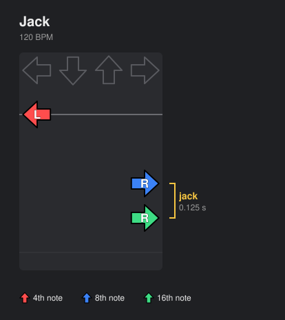
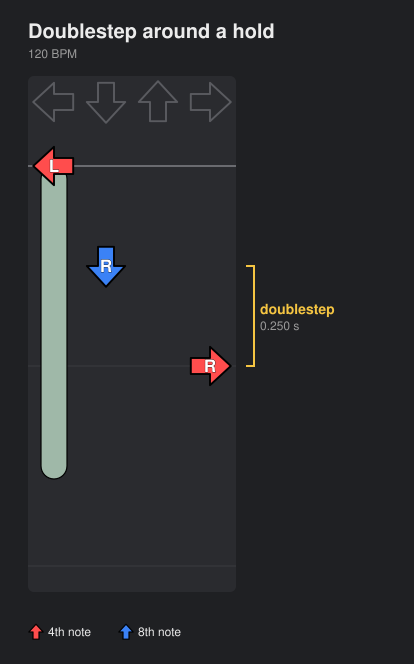
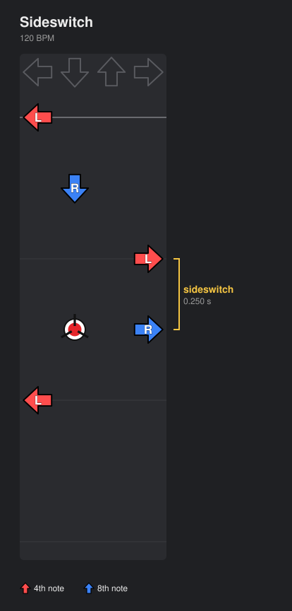
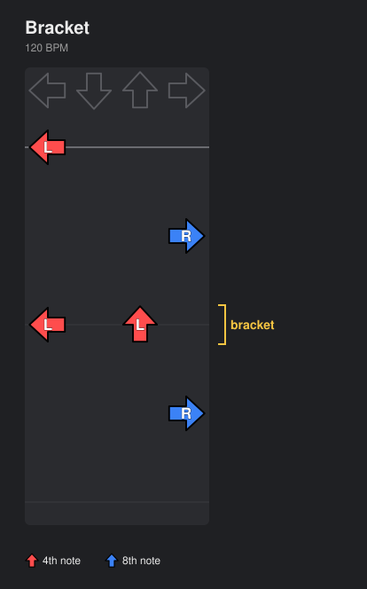
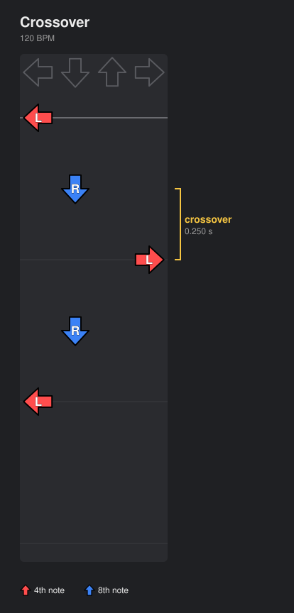
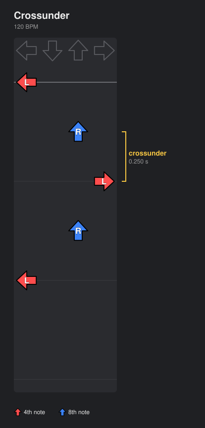
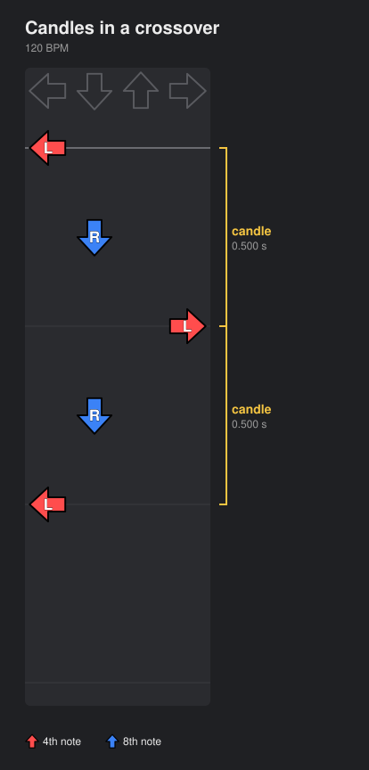

# Patterns

Tech patterns in `patternity` are detected based on the inferred foot path from the Viterbi solution. For detection code, see [`patterns/detector.py`](../src/patternity/patterns/detector.py).

Jacks and switches pair a panel only with the very next press row, as in ITGmania. Returning to a panel after other steps (Down, Up, Down in a stream) is neither.

## Jack

The same foot presses the same panel on consecutive steps.

> [!IMPORTANT]
> Counts only when the presses are less than **0.176 s** apart (faster than ~5.7 NPS, i.e. 170 BPM 8ths). A mine on the panel in between resets the timer. Hold tails don't count as presses.

The classic jack is a single foot repeatedly hitting the same arrow:

A jump can start a jack. Here the left foot lands the jump's Left and has to hit Left again on the very next 16th:

> [!TIP]
> Regenerate diagrams with `uv run python scripts/pattern_diagrams.py`.

## Doublestep

The same foot presses two different single panels in a row, while the other foot stays where it is.

> [!NOTE]
> It counts whether or not the other foot was free to step. A foot coming off a hold just before the second press doesn't excuse it, so a holdswitch is also a doublestep.

A hold anchors one foot, leaving the other to take consecutive arrows:

A mine can push a foot off its panel and onto the next arrow. In this Left, Down, Right, Up phrase, the mine on Down sends the right foot over to Right instead of the left foot crossing over:

## Footswitch

The player swaps feet on the same panel across consecutive steps.

> [!IMPORTANT]
> Counts only within **1/3 s** (≥ 3 NPS, inclusive of 90 BPM 8ths). A mine on the panel in between resets the timer, as for a jack. Switching onto a panel right after a hold/roll releases there (holdswitch) needs a mine cue after the release.

A mine under the left foot pushes it onto Down, where it takes over from the right foot:

## Sideswitch

A subset of `footswitches` where the player swaps feet on the Left or Right panels, generally requiring a turn to enter or exit the pattern.

The left foot crosses over to Right. A mine on Down cues the right foot off Down to take Right from the left foot, which returns to Left:

## Bracket

One foot presses two panels at the same time.

The left foot covers Left and Up together:

A crossover bracket has a foot bracket two panels on the far side of the other foot:

## Crossover

The legs cross so the player turns away from facing forward. A new crossover is counted each time the legs cross, or turn to a different crossed orientation while staying crossed. Stepping to an uncrossed stance ends it, even if the player stays turned.

Crossing in front: the left foot moves past the right foot, which is back on Down, to reach Right, then returns to Left:

Crossing behind (a crossunder): the right foot is forward on Up, so the left foot passes behind it to reach Right before returning to Left. Patternity counts crossunders as crossovers.

## Inverted Crossover

A crossover that turns the player to face backward (left foot on right arrow and right foot on left arrow). This most commonly occurs during laterals.

In this lateral, the left foot crosses over to Right and then the right foot sweeps across to Left so the player faces backward. The spin continues through Up and Right back to facing forward:

## Candle

One foot moves between opposite panels (Up↔Down or Left↔Right) between its own presses. The other foot's presses in between don't count. A bracket that keeps one of its panels (Left+Up to Left+Down) is not a candle.

In a run of alternating feet, a candle appears whenever a foot's next arrow is opposite its last one. Here the right foot goes from Down to Up, and later the left foot goes from Down to Up:

Left↔Right counts too, so the crossover from above has two candles. The crossing left foot moves from Left to Right, then from Right back to Left:

